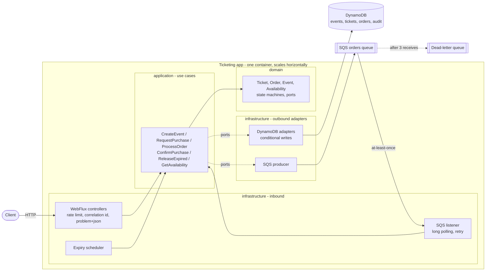
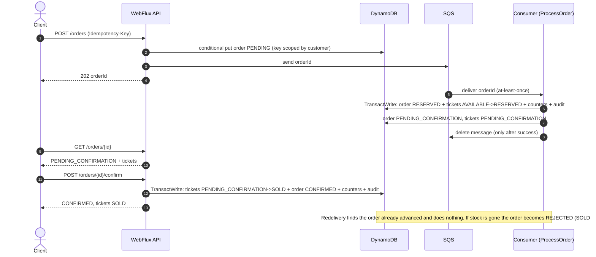
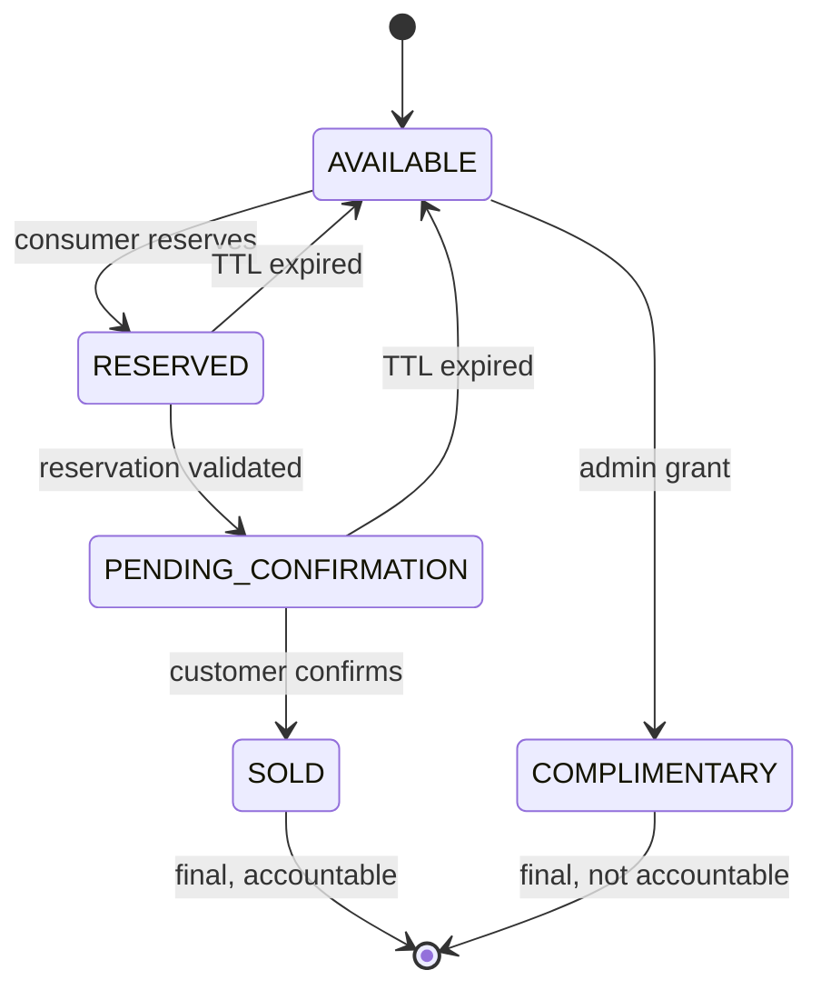
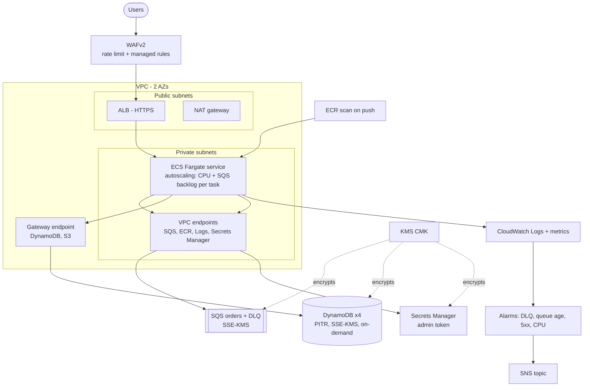

# Ticketing Platform

Reactive, event-driven backend for selling tickets under demand spikes without overselling. Java 25, Spring Boot 4.1, WebFlux, DynamoDB, SQS, Docker, Clean Architecture, with Terraform for AWS.

## Solution in brief

1. `POST /api/v1/orders` validates the request, stores a `PENDING` order (idempotent per customer + `Idempotency-Key`), enqueues the order id in SQS and returns **202** with an `orderId` immediately.
2. An SQS consumer (inside the same app) reserves tickets with DynamoDB transactional conditional writes, and moves the order to `PENDING_CONFIRMATION`. Reservations last 10 minutes.
3. The customer confirms (`POST /orders/{id}/confirm`): tickets become `SOLD` (final). If not confirmed in time, a scheduler returns the tickets to the pool.
4. Availability and order status are readable at any time (plus an SSE stream of availability).

Oversell is impossible by construction: every ticket changes state through a conditional update and the event counters change in the same all-or-nothing transaction (see [Concurrency](#concurrency-and-consistency)).

## Requirements traceability

| # | Requirement | Implementation |
|---|---|---|
| F1 | Event management (name, date, venue, capacity, inventory) | `CreateEventUseCase`, `QueryEventsUseCase`, `EventController`; one ticket item per seat + per-status counters on the event item |
| F2 | Temporary reservation, max 10 min | `ProcessOrderUseCase` reserves; `app.reservation.ttl=10m`; order carries `expiresAt` |
| F3 | Async purchase: enqueue, return order id, consumer validates/updates | `RequestPurchaseUseCase` -> `SqsOrderQueue` -> `SqsOrderListener` -> `ProcessOrderUseCase` |
| F4 | Order status query | `GET /api/v1/orders/{id}` (`GetOrderStatusUseCase`): order status plus ticket states |
| F5 | Concurrency control, no oversell | Conditional writes + version attribute + `TransactWriteItems`; `TicketingConcurrencyTest` and a 20-buyer E2E run |
| F6 | Automatic release of expired reservations | `ExpiryScheduler` -> `ReleaseExpiredReservationsUseCase` (every 30 s) using the sparse `status-expiry-index` |
| F7 | Reactive availability counting sold and held | `GET .../availability` and SSE `.../availability/stream` |
| T1 | Java 25 (records, pattern matching) | Records for domain/DTOs/config, `switch` pattern matching over enums and the sealed `DomainException` hierarchy. Virtual threads: not used (see [limitations](#known-limitations)) |
| T2 | Spring Boot 4.x + WebFlux, `Mono`/`Flux` | Boot 4.1.1, no blocking calls on request paths; async AWS SDK (Netty) |
| T3 | NoSQL persistence | DynamoDB (DynamoDB Local in compose) |
| T4 | Message queue | SQS (LocalStack in compose) |
| T5 | Docker | `Dockerfile` (multi-stage, non-root) and `docker-compose.yml` |
| T6 | Clean Architecture | `domain` -> `application` -> `infrastructure`, dependencies point inward only |
| T7 | Reactive error handling with retry | Bounded, jittered retry on DynamoDB contention; SQS processing retry for transient errors only; publish retries; RFC 9457 error documents |
| T8 | SQS at-least-once | Message deleted only after success; visibility timeout; DLQ after 3 receives; idempotent consumer |
| T9 | Optimistic locking / conditional writes | `status = :from AND version = :v` on tickets; `cntAvailable >= :q` on events |
| T10 | `docker-compose.yml` | App + DynamoDB Local + LocalStack (queue + DLQ created by init script) |
| D3 | Unit tests >= 90% | 245 tests; JaCoCo gate LINE >= 90%, BRANCH >= 80%; measured LINE 99.35%, BRANCH 88.48% |
| D4 | Request collection | `postman/` (Postman collection, `.http` file, curl script) |
| IaC | Terraform | `infra/terraform` (modules + dev/prod), see its [README](infra/terraform/README.md) |

## Prerequisites

- Docker with Compose v2 (Docker Desktop, Colima or similar). Nothing else: **no local JDK or Maven is required**, builds and tests run in containers.
- `curl` and `python3` for the smoke script and examples. Terraform >= 1.6 only for the infrastructure.

## Install, configure and run

```bash
git clone <repo-url> ticketing-platform && cd ticketing-platform

# Optional: override the admin token used for complimentary tickets (default: local-admin-token)
export ADMIN_TOKEN='choose-a-long-random-value'

docker compose up -d --build        # build the image and start app + DynamoDB Local + LocalStack
docker compose ps                   # wait until all three are "healthy" (app takes ~40 s)
curl -s localhost:8080/actuator/health
```

| Command | Purpose |
|---|---|
| `docker compose up -d --build` | build and start everything |
| `docker compose logs -f app` | follow application logs |
| `./scripts/smoke-test.sh` | end-to-end check: purchase, idempotency, confirmation, 20 parallel buyers on 7 tickets, admin token |
| `./postman/curl-examples.sh` | guided walk-through of the main flows |
| `docker compose down` | stop and remove containers (data is in memory and disappears) |

Configuration is by environment variables (see `src/main/resources/application.yml`): `RESERVATION_TTL` (default `10m`), `RESERVATION_RELEASE_INTERVAL` (`30s`), `RATE_LIMIT_CAPACITY` (`50`), `RATE_LIMIT_REFILL_PER_SECOND` (`25`), `SQS_CONCURRENCY` (`8`), `ADMIN_TOKEN` (no default in code). The compose file only contains throwaway dummy AWS credentials for the emulators.

### Run the tests (Docker only)

```bash
docker run --rm -v "$PWD":/app -v "$HOME/.m2":/root/.m2 -w /app \
  maven:3.9-eclipse-temurin-25 mvn -B verify
```

`verify` runs the 245 tests, generates the JaCoCo report and enforces the coverage gate (build fails below 90% line / 80% branch). Open **`target/site/jacoco/index.html`** for the report (`TicketingApplication` and the wiring in `infrastructure.config` are excluded; they are covered by `ApplicationWiringTest` but are pure configuration).

## API

Base URL `http://localhost:8080`. Errors are `application/problem+json` (RFC 9457) and never echo rejected input. Every response carries `X-Correlation-Id` (send your own or one is generated).

| Method and path | Description | Success |
|---|---|---|
| `POST /api/v1/events` | create event | 201 |
| `GET /api/v1/events` | list events (bounded to 500) | 200 |
| `GET /api/v1/events/{id}` | get event | 200 |
| `GET /api/v1/events/{id}/availability` | counts per state | 200 |
| `GET /api/v1/events/{id}/availability/stream` | SSE, emits on change (checked every 2 s) | 200 |
| `POST /api/v1/orders` | request purchase, header `Idempotency-Key` required | 202 + `Location` |
| `GET /api/v1/orders/{id}` | order status and ticket states | 200 |
| `POST /api/v1/orders/{id}/confirm` | confirm; tickets become SOLD | 200 |
| `POST /api/v1/events/{id}/complimentary` | header `X-Admin-Token`; tickets become COMPLIMENTARY | 201 |
| `GET /actuator/health`, `/actuator/prometheus` | health and metrics | 200 |

Error codes: 400 validation or malformed id or missing/invalid `Idempotency-Key`; 403 bad admin token; 404 unknown event/order; 409 invalid state transition or contention; 410 confirming an expired reservation; 422 same `Idempotency-Key` with a different payload; 429 rate limited (with `Retry-After`); 503 queue unavailable.

```bash
# 1. Create an event
curl -s -X POST localhost:8080/api/v1/events -H 'Content-Type: application/json' \
  -d '{"name":"Rock Night","date":"2035-06-01T20:00:00Z","venue":"Arena","capacity":50}'
EVENT_ID=<id from the response>

# 2. Availability (sold + held are both subtracted from "available")
curl -s localhost:8080/api/v1/events/$EVENT_ID/availability
# {"eventId":"...","capacity":50,"available":50,"reserved":0,"pendingConfirmation":0,"sold":0,"complimentary":0,"unavailable":0}

# 3. Purchase: 202 immediately; retrying with the same key returns the same order
curl -s -X POST localhost:8080/api/v1/orders -H 'Content-Type: application/json' \
  -H 'Idempotency-Key: order-2026-0001' \
  -d "{\"eventId\":\"$EVENT_ID\",\"customerId\":\"customer-001\",\"quantity\":2}"
# {"orderId":"930b84b8-...","status":"PENDING"}
ORDER_ID=<orderId>

# 4. Poll: PENDING -> RESERVED -> PENDING_CONFIRMATION
curl -s localhost:8080/api/v1/orders/$ORDER_ID
# {"orderId":"...","status":"PENDING_CONFIRMATION","ticketStatus":"PENDING_CONFIRMATION","quantity":2,"expiresAt":"...","tickets":[{"ticketId":"T-000001","status":"PENDING_CONFIRMATION"},...]}

# 5. Confirm: order CONFIRMED, tickets SOLD
curl -s -X POST localhost:8080/api/v1/orders/$ORDER_ID/confirm

# 6. Complimentary tickets (admin only): 201 with the token, 403 without
curl -s -X POST localhost:8080/api/v1/events/$EVENT_ID/complimentary -H 'Content-Type: application/json' \
  -H "X-Admin-Token: ${ADMIN_TOKEN:-local-admin-token}" -d '{"quantity":2}'

# 7. Live availability (SSE)
curl -N localhost:8080/api/v1/events/$EVENT_ID/availability/stream
```

`postman/ticketing-platform.postman_collection.json` (Postman v2.1; test scripts capture `eventId`/`orderId` and assert the flows, verified with Newman against the compose stack), `postman/requests.http` and `postman/curl-examples.sh` cover the same flows plus error cases. The SSE request in Postman stays open until cancelled (expected).

## Architecture



Dependency rule: `domain` knows nothing about Spring or AWS; `application` depends only on domain ports; `infrastructure` implements ports and wires everything (`config` package). Swapping DynamoDB or SQS means writing a new adapter, not touching a use case.

### Purchase sequence



### Ticket states



Order status machine: `PENDING -> RESERVED -> PENDING_CONFIRMATION -> CONFIRMED`, with `PENDING -> REJECTED` (no stock) and `RESERVED | PENDING_CONFIRMATION -> EXPIRED`. Illegal transitions throw `InvalidStateTransitionException` (409). Every ticket transition writes an append-only row to the audit table in the same transaction (ticket, from status, to status, reason, timestamp). RESERVED and PENDING_CONFIRMATION are holds, never sales; only SOLD counts as revenue.

### AWS deployment



## Concurrency and consistency

- **No oversell, layered**: (1) each ticket is its own item changed only by a conditional update (`status = :from AND version = :v`), so two buyers can never own one seat; (2) the event item holds per-status counters and a reservation requires `cntAvailable >= :q` in the same transaction; (3) order, tickets, counters and audit rows are written in a single `TransactWriteItems`, all or nothing. Losing a race on specific tickets retries with fresh random candidates (bounded attempts, jittered backoff); losing it on the counter means sold out.
- **Why conditional writes instead of locks**: no distributed lock to hold, expire or fence. Contention is resolved by DynamoDB atomically, and the reactive threads never block.
- **Hot-spot avoidance**: candidate tickets are picked randomly from a sparse GSI (`available-index`, only AVAILABLE tickets), so concurrent consumers rarely collide on the same seats.
- **Reservation TTL + scheduler**: orders keep `expiresAt`; a sparse GSI (`status-expiry-index`) lets the scheduler read only holds that are due. Each release is a conditional write, so running several instances is harmless. Confirming after expiry returns 410 even before the scheduler runs.
- **SQS standard queue, not FIFO**: standard queues give far higher throughput and no per-group head-of-line blocking; correctness does not depend on ordering because the consumer is idempotent (it dispatches on the persisted order status) and every write is conditional. FIFO would add deduplication windows and throughput limits and still would not remove the need for conditional writes.
- **Failure handling**: the message is deleted only after success; transient errors are retried in-process, permanent ones are left for redelivery; after 3 receives the DLQ takes it (verified end to end with a poison message). A crash between reserving and `PENDING_CONFIRMATION` recovers through redelivery.
- **Audit trail**: each state change is an append-only row, written transactionally with the change itself.

## Security

- **Secrets**: no secret in code, image or compose defaults. `ADMIN_TOKEN` comes from the environment locally and from AWS Secrets Manager (KMS-encrypted, injected by ECS) in the cloud; Terraform only creates a placeholder and ignores later value changes. AWS credentials come from the default provider chain (task role in AWS).
- **Idempotency and replay**: `Idempotency-Key` is mandatory (`[A-Za-z0-9._-]{1,64}`) and scoped per customer, so one customer cannot replay or probe another's order; the same key with a different payload returns 422. Confirm is idempotent. Retried SQS deliveries are no-ops.
- **Abuse protection**: per-client token bucket rate limiting (429 + `Retry-After`; behind the ALB it uses the last `X-Forwarded-For` hop, which the ALB appends, instead of the spoofable first one), bounded quantities (max 10 tickets per order), bounded list size, strict id validation and Bean Validation on every body, WAF in AWS.
- **Privileged operations**: complimentary grants need `X-Admin-Token`, compared in constant time; an unset token denies everything (fail closed).
- **No data leakage**: queue messages carry only the order id; errors are generic problem documents without stack traces or echoed input; the idempotency key never appears in responses.
- **Least-privilege IAM**: the task role may only use item-level DynamoDB actions on the four tables and two indexes (no delete, no table admin, `Scan` on events only) and six SQS actions on one queue.
- **Encryption**: TLS at the ALB, TLS-only queue policy, one rotating KMS key for DynamoDB, SQS, SNS, ECR and the secret. Container runs as a non-root user; images are scanned on push.
- **Not done**: end-user authentication (anyone can call the public API); see improvement scenarios.

## Resilience, observability, cost and governance on AWS

- **Resilience**: stateless tasks across two AZs, autoscaling on CPU and SQS backlog per task, circuit-breaker deployments with rollback, graceful shutdown, DLQ with an alarm, PITR backups, multi-AZ NAT in prod.
- **Observability**: request logs with correlation ids, Prometheus metrics (`/actuator/prometheus`, order counters), Container Insights, CloudWatch alarms (DLQ depth, oldest message age, ALB 5xx, unhealthy targets, ECS CPU) to SNS, VPC flow logs.
- **Cost**: DynamoDB on-demand and Fargate pay for use; the fixed costs are the NAT gateway(s), interface endpoints, ALB and (prod) WAF. Dev uses one NAT and one task; details in the [Terraform README](infra/terraform/README.md#cost-considerations-us-east-1-indicative).
- **Governance**: `default_tags` (Project, Environment, ManagedBy, Owner, CostCenter), separate state and variables per environment (ideally separate accounts), KMS, CloudTrail/Config/SCPs recommended at the organization level.

## Known limitations

- Availability picks tickets through an eventually consistent GSI, so under a burst it can under-report stock for a moment; it can never oversell (the conditional writes decide).
- The event item holds the counters: it is a hot key at very high write rates (a single DynamoDB partition sustains about 1,000 writes/s per item).
- Expiry discovery uses a status GSI with a low-cardinality hash key (`status`), which can concentrate load at very large scale.
- `GET /events` is a bounded scan (500 items); it needs pagination or an index for large catalogs.
- Rate limiting is in memory per instance (limits multiply with the number of tasks) and keyed by IP only.
- An order reserved by a consumer that crashes before `PENDING_CONFIRMATION` recovers only through SQS redelivery (visibility timeout 60 s).
- No end-user authentication and no payment: "confirm" represents the payment step.
- Virtual threads are not used: the stack is end-to-end non-blocking (Netty event loops + async AWS SDK), so there is no blocking work to offload. They would help if a blocking client (JDBC, a legacy SDK) were added.
- Integration against real DynamoDB/SQS semantics is covered by the compose smoke test and unit tests with mocked clients; there are no Testcontainers/LocalStack tests in the Maven build yet.
- The Terraform code has been formatted and validated, but never applied against a real AWS account.

## Improvement scenarios

| Scenario | Why / trade-off |
|---|---|
| Sharded counters for hot events (N counter items, sum on read) | Removes the single hot item for mega on-sales; reads cost N queries and exact "sold out" needs a final check. |
| FIFO queue with message groups, or one queue per event/partition | Orders per event are serialized and hot events are isolated; lower throughput per group and more queues to operate. |
| DynamoDB Streams + EventBridge (transactional outbox) | Reliable domain events (emails, reporting, analytics) without dual writes; adds latency and another moving part. |
| Waiting room / virtual queue for spikes | Protects the system and gives users a fair order; needs a token service and UX work. |
| Distributed rate limiting (Redis or WAF rate rules per API key) | Limits stay correct as tasks scale; Redis is another dependency and failure mode. |
| Payment integration and saga for confirmation timeouts | Real money flow with compensation if payment succeeds after expiry; requires idempotent payment callbacks. |
| Testcontainers/LocalStack integration tests in CI | Verifies real DynamoDB/SQS behavior on every PR; slower pipelines. |
| CI/CD pipeline with Terraform plan, policy checks and GitHub OIDC | Reviewed, reproducible deploys without long-lived keys; needs per-environment roles and approvals. |
| OpenTelemetry tracing (ADOT sidecar to X-Ray) | End-to-end latency across API, queue and consumer; some overhead and sampling decisions. |
| Multi-region (DynamoDB global tables, Route 53 failover) | Regional resilience and lower latency; global tables are last-writer-wins, so conditional-write guarantees need a single write region per event. |
| Chaos testing (AWS FIS: kill tasks, throttle DynamoDB, delay SQS) | Proves the retry/DLQ/recovery paths under real faults; needs a safe environment and guardrails. |
| Load tests with k6 or Gatling in CI | Quantifies capacity and regression of p95/p99 under on-sale traffic; test data and environment cost. |
| API authentication with Cognito/JWT | Real user identity, per-user limits and ownership checks on orders; token management and a login flow. |
| DynamoDB TTL for expiry | Cheap cleanup of old orders/idempotency items; TTL deletion is delayed (up to 48 h), so it cannot replace the scheduler for releasing tickets. |
| Resilience4j circuit breakers and bulkheads | Fail fast when SQS or DynamoDB degrade instead of piling up; thresholds need tuning to avoid false trips. |
| Pagination and a by-date index for event listing | Removes the bounded scan; slightly more complex queries. |
| Fargate Spot / Graviton, scheduled scaling before known on-sales | Lower cost and warm capacity at release time; Spot interruptions need graceful handling. |

## Repository layout

```
src/main/java/com/nequi/ticketing
  domain/           model, ports, exceptions (no framework imports)
  application/      use cases
  infrastructure/   web, persistence/dynamodb, messaging/sqs, scheduler, metrics, config
src/test/java       unit, adapter, web and concurrency tests (in-memory fakes in support/)
docker/localstack   queue + DLQ init script
scripts/            smoke-test.sh (end-to-end)
postman/            collection, .http file, curl script
infra/terraform     modules and dev/prod environments
odd/tasks           implementation plan and evidence
```
